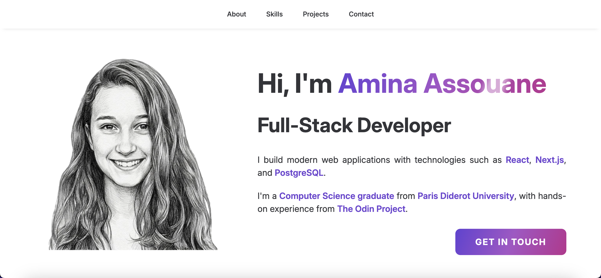
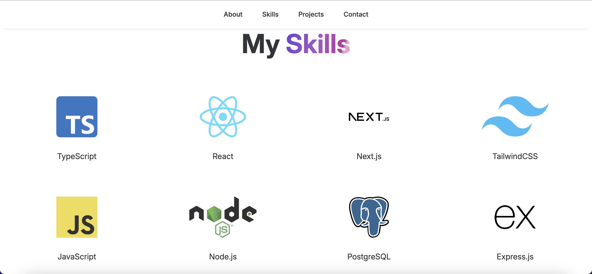
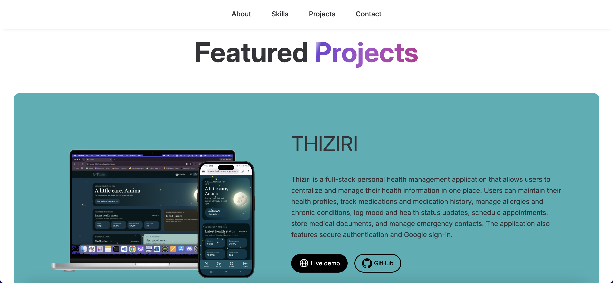
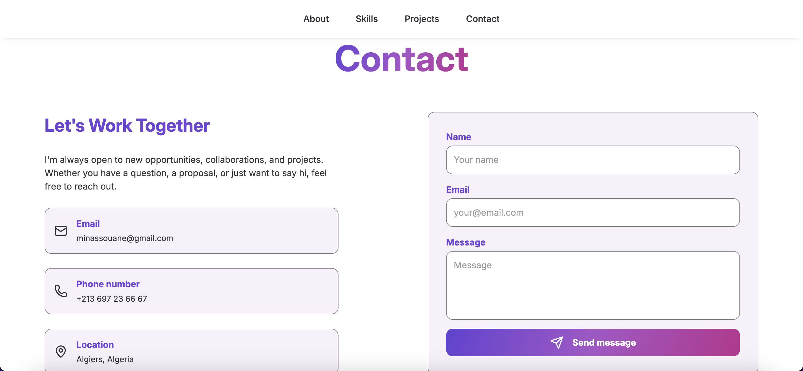

# ✨ Amina Assouane — Portfolio

My personal developer portfolio, built to showcase my projects, technical skills, and journey as a Full-Stack Developer.

🌐 **Live Website:** [amina-assouane.vercel.app](https://amina-assouane.vercel.app)

## 📸 Screenshots

### Homepage



### Skills



### Projects



### Contact



## 🛠️ Tech Stack

- **React 19** – Building the user interface
- **JavaScript** – Application logic
- **Tailwind CSS v4** – Styling and layout
- **Vite** – Development server and build tool
- **EmailJS** – Handling contact form submissions
- **Lucide React** – Icons

## ✨ Features

- **About section** – Introduction and developer background
- **Skills section** – Overview of technical skills
- **Projects section** – Showcases selected projects with links to their live demos and repositories
- **Contact form** – Allows visitors to get in touch via email
- **Responsive design** – Adapts to different screen sizes and devices
- **Smooth navigation** – Easy access to the different sections of the portfolio

## 🚀 Featured Projects

### Thiziri

A personal health-management application that helps users organize and keep track of their health information.

- [Live Demo](https://amina-thiziri.vercel.app)
- [GitHub Repository](https://github.com/AminaAssouane/thiziri)

### Ocean

A full-stack social networking application featuring posts, comments, likes, and following functionality.

- [Live Demo](https://amina-ocean.vercel.app)
- [GitHub Repository](https://github.com/AminaAssouane/ocean)

### Swan

A real-time messaging application featuring global chat, private conversations, and group conversations.

- [Live Demo](https://amina-swan.vercel.app)
- [GitHub Repository](https://github.com/AminaAssouane/messaging-app)

### DevMinds

A full-stack blogging platform organized into three separate applications:

- **blog-client** – Public-facing interface where readers can explore and read articles
- **blog-admin** – Admin dashboard for managing blog content
- **blog-api** – Backend API powering the platform

- [Live Demo](https://devminds-client.vercel.app)
- [GitHub Repository](https://github.com/AminaAssouane/blog-client)

## 💻 Getting Started

To run the project locally:

1. Clone the repository:

   ```bash
   git clone <repository-url>
   ```

2. Navigate to the project directory:

   ```bash
   cd portfolio
   ```

3. Install dependencies:

   ```bash
   npm install
   ```

4. Start the development server:

   ```bash
   npm run dev
   ```

5. Open the local URL provided by Vite in your browser.

## 👩🏻‍💻 Built By

**Amina Assouane**

[GitHub](https://github.com/AminaAssouane) · [Portfolio](https://amina-assouane.vercel.app)
